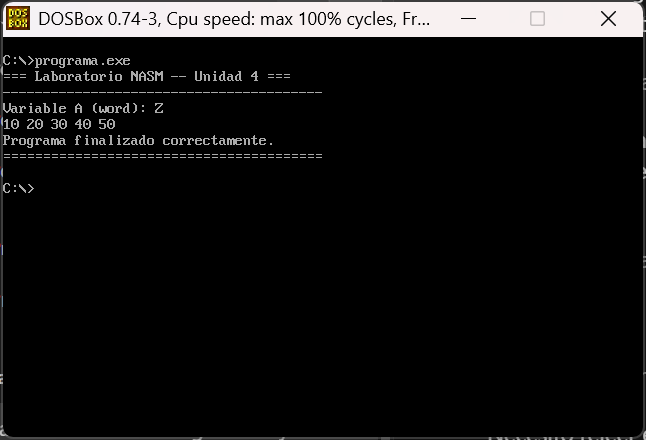

# salas-post1-u4

## Descripción

Laboratorio de la Unidad 4 de Arquitectura de Computadores: programa NASM con segmentos y salida DOS (Parte 1) y macros con control de flujo (Parte 2).

La Parte 1 construye un programa NASM de 16 bits con las secciones `.data`, `.bss` y `.text`, las directivas de datos y constantes (`DB`, `DW`, `DD`, `RESB`, `RESW`, `EQU`, `TIMES`) y salida por pantalla mediante las funciones 09h y 02h de la interrupción 21h del DOS. La Parte 2 introduce macros con parámetros, etiquetas locales y una macro basada en `%rep`, además de estructuras de control de flujo (`LOOP`, `CMP`/`Jcc`).

## Prerrequisitos

- DOSBox 0.74+ (se utilizó DOSBox 0.74-3)
- NASM 2.14+ (se utilizó NASM 3.02 para DOS, `nasm.exe`)
- ALINK 1.6 (`alink.exe`)
- `cwsdpmi.exe`: host DPMI que `alink.exe` y `nasm.exe` (versión DOS extendida) requieren dentro de DOSBox
- Editor de texto plano (VS Code); los archivos `.asm` se guardan en ASCII, sin BOM

## Estructura del repositorio

```
salas-post1-u4/
├── README.md        ; documentación de ambas partes
├── programa.asm     ; Parte 1: secciones, directivas, INT 21h y TIMES
└── capturas/        ; capturas de pantalla de DOSBox
```

## Compilación y ejecución (Parte 1)

```
Z:\> mount C C:\Users\Cesar\lab-post1-u4
Z:\> C:
C:\> cwsdpmi -p
C:\> nasm -f obj programa.asm -o programa.obj
C:\> alink programa.obj -oEXE -o programa.exe -entry main
C:\> programa.exe
```

`cwsdpmi -p` deja residente el host DPMI una sola vez por sesión de DOSBox; sin él, `alink` termina con el error `No DPMI-host found!`.

Salida esperada:

```
=== Laboratorio NASM -- Unidad 4 ===
----------------------------------------
Variable A (word): Z
10 20 30 40 50
Programa finalizado correctamente.
========================================
```

### Notas de implementación (Parte 1)

- El formato `-f obj` trata cada sección como un segmento independiente. Por ello `main` carga DS con `mov ax, seg bienvenida` (el segmento de `.data`) en lugar de `@data`, símbolo que NASM no define.
- Un `.EXE` de DOS requiere un segmento de pila. El programa declara `segment pila stack class=STACK` con `resb 256`, que ALINK reconoce para inicializar SS:SP.
- Los elementos de `tabla_bytes` (10, 20, 30, 40, 50) tienen dos dígitos; sumarles `30h` produciría caracteres que no son dígitos. El recorrido usa `AAM` para separar decenas y unidades y las imprime como dos dígitos ASCII, de modo que la salida coincide con los valores definidos en `.data`.
- El carácter `Z` proviene de `var_byte` (42) más `30h` = 90 = `"Z"`, tal como lo plantea el enunciado.

### Capturas (Parte 1)

| Checkpoint | Captura |
|---|---|
| 1. Ensamblado y enlazado exitosos | `capturas/p1_checkpoint1_ensamblado_enlazado.png` |
| 2. Ejecución y salida en DOSBox | `capturas/p1_checkpoint2_ejecucion.png` |
| 3. Línea decorativa con `TIMES` | `capturas/p1_checkpoint3_linea_times.png` |




## Decisiones técnicas (Parte 1)

### Decisión 1: `EQU` frente a `%define` para `ANCHO_LINEA`

`EQU` define un símbolo numérico que el ensamblador propiamente dicho evalúa y verifica: el valor queda resuelto como un número, y un segundo `EQU` con el mismo nombre produce un error de redefinición, de modo que el valor no cambia silenciosamente. `%define`, en cambio, es una sustitución de texto del preprocesador, ejecutada antes de que NASM ensamble una sola instrucción; el preprocesador pega los caracteres sin evaluarlos, permite redefinir el nombre y no comprueba que el resultado tenga sentido. Por eso `%define ANCHO_LINEA 20+20` seguido de `ANCHO_LINEA*2` se expande a `20+20*2`, es decir 60 y no 80, mientras que `EQU` produce 40 y luego 80. Como `ANCHO_LINEA` se usa como argumento numérico de `TIMES` y podría intervenir en una comparación aritmética posterior, `EQU` evita mejor la sustitución ambigua o mal formada y es el mecanismo correcto. `%define` sí sería adecuado en este mismo programa para un fragmento de texto repetido literalmente: `%define FIN_LINEA CR, LF, TERMINADOR` reemplazaría la secuencia que cierra cada cadena de `.data`, algo que un `EQU` no puede representar porque no es un valor numérico único.

### Decisión 2: `TIMES` en `.data` frente a `RESB` con relleno en tiempo de ejecución

Escribir a mano cuarenta signos `=` dentro del literal `DB` obliga a contarlos cada vez que cambie el ancho; con `TIMES ANCHO_LINEA DB '='` basta modificar un único número, y el ensamblador genera los bytes exactos sin riesgo de contar mal. Reservar `RESB 40` en `.bss` y llenarlo con un bucle `LOOP` al inicio de `main` sería una alternativa válida en principio, pero innecesaria aquí: el contenido de la línea es idéntico en cada ejecución, de modo que construirlo dinámicamente no aporta flexibilidad alguna. El costo se aprecia en instrucciones ejecutadas al arrancar. Con `TIMES`, los 40 bytes ya forman parte de la imagen del ejecutable y el arranque ejecuta cero instrucciones para prepararlos. Con `RESB` más bucle, se ejecutarían unas cuantas instrucciones de preparación (`mov cx`, carga del puntero, `mov` del terminador) y, por cada una de las 40 iteraciones, al menos un `mov` de almacenamiento, un `inc` y un `loop`, es decir más de cien instrucciones en cada arranque, además de tener que escribir también `CR`, `LF` y `$`. El precio de `TIMES` es que el `.EXE` contiene 43 bytes más, una diferencia despreciable frente al ahorro.
