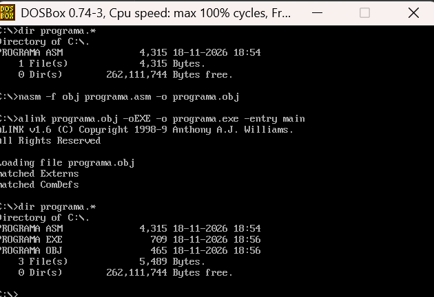
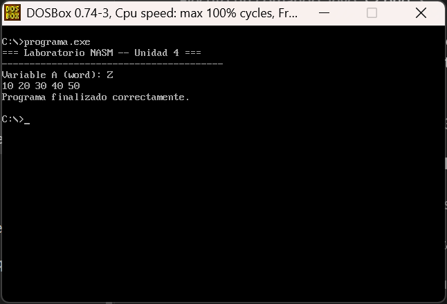
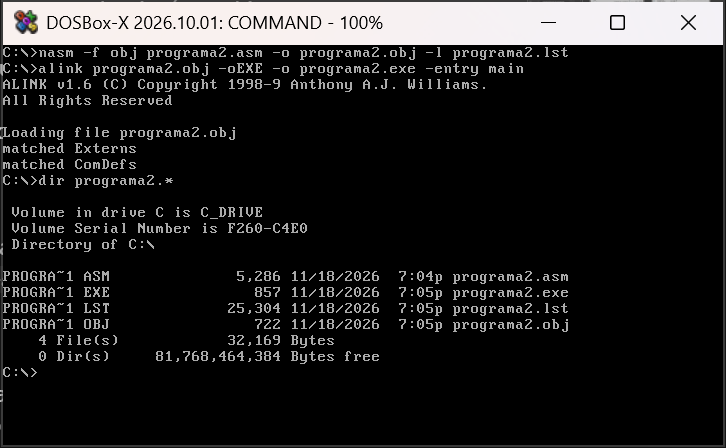
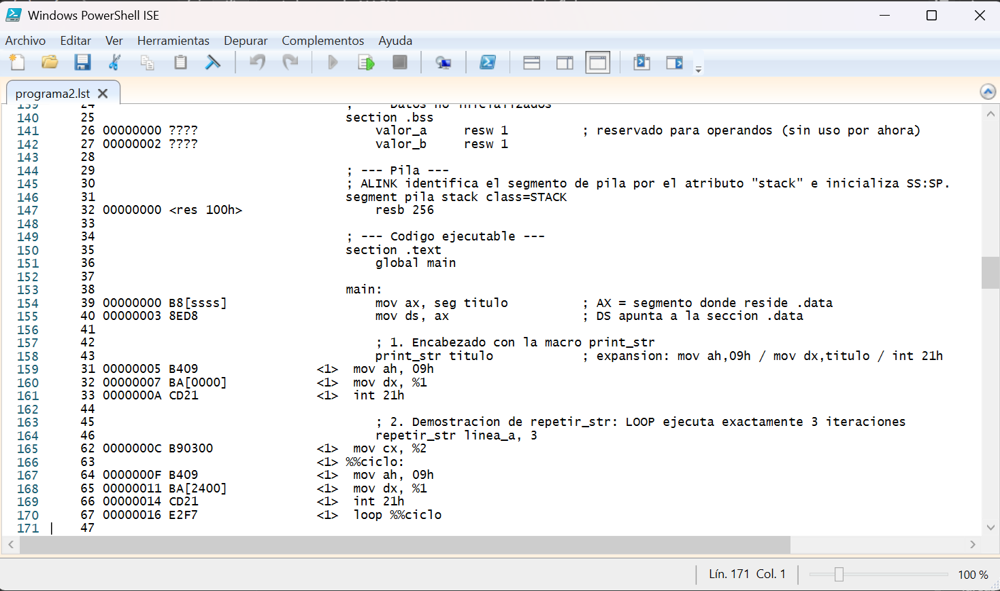
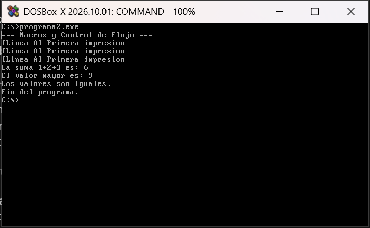
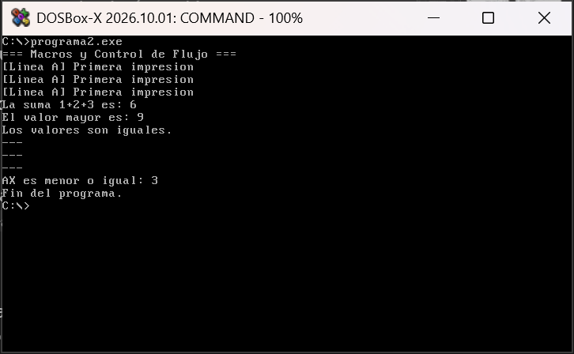
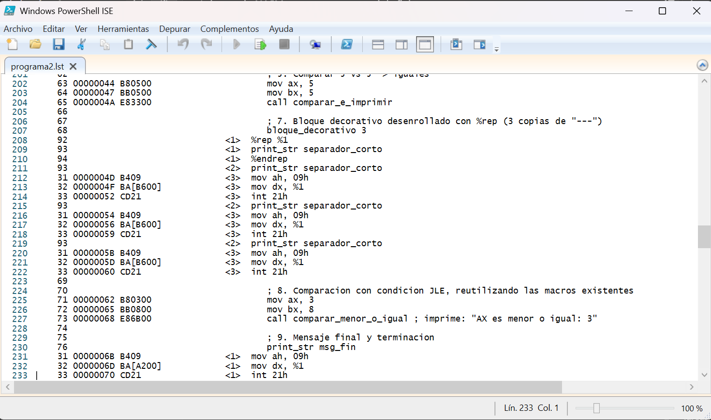
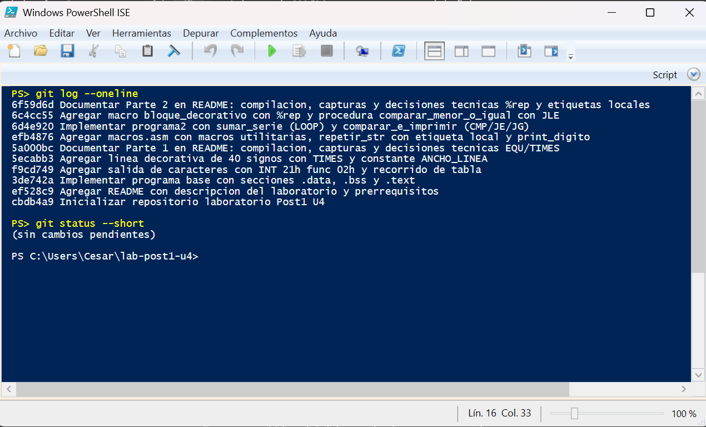

# salas-post1-u4

## Descripción

Laboratorio de la Unidad 4 de Arquitectura de Computadores: programa NASM con segmentos y salida DOS (Parte 1) y macros con control de flujo (Parte 2).

La Parte 1 construye un programa NASM de 16 bits con las secciones `.data`, `.bss` y `.text`, las directivas de datos y constantes (`DB`, `DW`, `DD`, `RESB`, `RESW`, `EQU`, `TIMES`) y salida por pantalla mediante las funciones 09h y 02h de la interrupción 21h del DOS. La Parte 2 introduce macros con parámetros, etiquetas locales y una macro basada en `%rep`, además de estructuras de control de flujo (`LOOP`, `CMP`/`Jcc`).

## Prerrequisitos

- DOSBox 0.74+ (se utilizó DOSBox 0.74-3 para la Parte 1)
- DOSBox-X con nombres largos (`lfn=true`) para la Parte 2, porque `programa2.asm` excede el formato 8.3 de DOS
- NASM 2.14+ (se utilizó NASM 3.02 para DOS, `nasm.exe`)
- ALINK 1.6 (`alink.exe`)
- `cwsdpmi.exe`: host DPMI que `alink.exe` y `nasm.exe` (versión DOS extendida) requieren dentro de DOSBox
- Editor de texto plano (VS Code); los archivos `.asm` se guardan en ASCII, sin BOM

## Estructura del repositorio

```
salas-post1-u4/
├── README.md        ; documentación de ambas partes
├── programa.asm     ; Parte 1: secciones, directivas, INT 21h y TIMES
├── macros.asm       ; Parte 2: biblioteca de macros (incluye %rep)
├── programa2.asm    ; Parte 2: macros, LOOP y CMP/Jcc
├── programa2.lst    ; Parte 2: listado con las macros expandidas
└── capturas/        ; capturas de pantalla de DOSBox
```

## Compilación y ejecución (Parte 1)

```
Z:\> mount C C:\Users\Cesar\lab-post1-u4
Z:\> C:
C:\> cwsdpmi -p
C:\> nasm -f obj programa.asm -o programa.obj
C:\> alink programa.obj -oEXE -o programa.exe -entry main
C:\> programa.exe
```

`cwsdpmi -p` deja residente el host DPMI una sola vez por sesión de DOSBox; sin él, `alink` termina con el error `No DPMI-host found!`.

Salida esperada:

```
=== Laboratorio NASM -- Unidad 4 ===
----------------------------------------
Variable A (word): Z
10 20 30 40 50
Programa finalizado correctamente.
========================================
```

### Notas de implementación (Parte 1)

- El formato `-f obj` trata cada sección como un segmento independiente. Por ello `main` carga DS con `mov ax, seg bienvenida` (el segmento de `.data`) en lugar de `@data`, símbolo que NASM no define.
- Un `.EXE` de DOS requiere un segmento de pila. El programa declara `segment pila stack class=STACK` con `resb 256`, que ALINK reconoce para inicializar SS:SP.
- Los elementos de `tabla_bytes` (10, 20, 30, 40, 50) tienen dos dígitos; sumarles `30h` produciría caracteres que no son dígitos. El recorrido usa `AAM` para separar decenas y unidades y las imprime como dos dígitos ASCII, de modo que la salida coincide con los valores definidos en `.data`.
- El carácter `Z` proviene de `var_byte` (42) más `30h` = 90 = `"Z"`, tal como lo plantea el enunciado.

### Capturas (Parte 1)

| Checkpoint | Captura |
|---|---|
| 1. Ensamblado y enlazado exitosos | `capturas/p1_checkpoint1_ensamblado_enlazado.png` |
| 2. Ejecución y salida en DOSBox | `capturas/p1_checkpoint2_ejecucion.png` |
| 3. Línea decorativa con `TIMES` | `capturas/p1_checkpoint3_linea_times.png` |





## Decisiones técnicas (Parte 1)

### Decisión 1: `EQU` frente a `%define` para `ANCHO_LINEA`

`EQU` define un símbolo numérico que el ensamblador propiamente dicho evalúa y verifica: el valor queda resuelto como un número, y un segundo `EQU` con el mismo nombre produce un error de redefinición, de modo que el valor no cambia silenciosamente. `%define`, en cambio, es una sustitución de texto del preprocesador, ejecutada antes de que NASM ensamble una sola instrucción; el preprocesador pega los caracteres sin evaluarlos, permite redefinir el nombre y no comprueba que el resultado tenga sentido. Por eso `%define ANCHO_LINEA 20+20` seguido de `ANCHO_LINEA*2` se expande a `20+20*2`, es decir 60 y no 80, mientras que `EQU` produce 40 y luego 80. Como `ANCHO_LINEA` se usa como argumento numérico de `TIMES` y podría intervenir en una comparación aritmética posterior, `EQU` evita mejor la sustitución ambigua o mal formada y es el mecanismo correcto. `%define` sí sería adecuado en este mismo programa para un fragmento de texto repetido literalmente: `%define FIN_LINEA CR, LF, TERMINADOR` reemplazaría la secuencia que cierra cada cadena de `.data`, algo que un `EQU` no puede representar porque no es un valor numérico único.

### Decisión 2: `TIMES` en `.data` frente a `RESB` con relleno en tiempo de ejecución

Escribir a mano cuarenta signos `=` dentro del literal `DB` obliga a contarlos cada vez que cambie el ancho; con `TIMES ANCHO_LINEA DB '='` basta modificar un único número, y el ensamblador genera los bytes exactos sin riesgo de contar mal. Reservar `RESB 40` en `.bss` y llenarlo con un bucle `LOOP` al inicio de `main` sería una alternativa válida en principio, pero innecesaria aquí: el contenido de la línea es idéntico en cada ejecución, de modo que construirlo dinámicamente no aporta flexibilidad alguna. El costo se aprecia en instrucciones ejecutadas al arrancar. Con `TIMES`, los 40 bytes ya forman parte de la imagen del ejecutable y el arranque ejecuta cero instrucciones para prepararlos. Con `RESB` más bucle, se ejecutarían unas cuantas instrucciones de preparación (`mov cx`, carga del puntero, `mov` del terminador) y, por cada una de las 40 iteraciones, al menos un `mov` de almacenamiento, un `inc` y un `loop`, es decir más de cien instrucciones en cada arranque, además de tener que escribir también `CR`, `LF` y `$`. El precio de `TIMES` es que el `.EXE` contiene 43 bytes más, una diferencia despreciable frente al ahorro.

## Compilación y ejecución (Parte 2)

`programa2.asm` tiene un nombre de 9 caracteres, que excede el formato 8.3 de DOS: DOSBox 0.74 no lo lista y lo confunde con `programa.asm`. Por ello la Parte 2 se ensambla, se enlaza y se ejecuta en **DOSBox-X** con nombres largos activados (`ver=7.1` y `lfn=true` en la sección `[dos]` de la configuración). Los comandos son los mismos del enunciado:

```
Z:\> mount C C:\Users\Cesar\lab-post1-u4
Z:\> C:
C:\> cwsdpmi -p
C:\> nasm -f obj programa2.asm -o programa2.obj -l programa2.lst
C:\> alink programa2.obj -oEXE -o programa2.exe -entry main
C:\> programa2.exe
```

La opción `-l programa2.lst` genera el listado con el código expandido de cada macro (líneas marcadas con `<1>`, `<2>`, `<3>` según el nivel de expansión). El archivo `programa2.lst` se incluye en el repositorio.

Salida esperada:

```
=== Macros y Control de Flujo ===
[Linea A] Primera impresion
[Linea A] Primera impresion
[Linea A] Primera impresion
La suma 1+2+3 es: 6
El valor mayor es: 9
Los valores son iguales.
---
---
---
AX es menor o igual: 3
Fin del programa.
```

### Contenido de la Parte 2

| Archivo | Contenido |
|---|---|
| `macros.asm` | `fin_dos`, `nueva_linea`, `print_str`, `print_char`, `leer_char`, `repetir_str` (con etiqueta local `%%ciclo`), `print_digito` y `bloque_decorativo` (basada en `%rep`) |
| `programa2.asm` | `main`, los procedimientos `sumar_serie` (bucle con `LOOP`), `comparar_e_imprimir` (`CMP` con `JE`/`JG`) y `comparar_menor_o_igual` (`CMP` con `JLE`) |
| `programa2.lst` | listado de NASM con las macros expandidas y el código máquina |

### Notas de implementación (Parte 2)

- La función 09h de DOS devuelve `AL = "$"` al terminar. Por eso `print_digito`, que lee el valor en `AL`, imprimiría `4` (el nibble bajo de `24h`) si se invocara justo después de `print_str`. El programa evita ese error de dos maneras: imprime la etiqueta antes de calcular la suma, y en los dos procedimientos de comparación copia el valor a `BL` antes de `print_str` y lo restaura en `AL` después. `BX` se preserva con `PUSH`/`POP`, de modo que usar `BL` como temporal no afecta al llamador.
- `sumar_serie` preserva `CX` con `PUSH`/`POP`, porque `LOOP` lo decrementa hasta cero.
- `print_digito` solo es correcta para valores 0-9; la suma 1+2+3 = 6 respeta ese límite.
- El mensaje de la suma usa una cadena propia (`msg_suma`) en lugar de reutilizar `msg_mayor`, para que la salida describa lo que se imprime.

### Capturas (Parte 2)

| Checkpoint | Captura |
|---|---|
| 1. Ensamblado y enlazado (con `-l programa2.lst`) | `capturas/p2_checkpoint1_ensamblado_enlazado.png` |
| 1. Listado `.lst` abierto en un editor, con las expansiones de `print_str` y `repetir_str` | `capturas/p2_checkpoint1_listado_lst.png` |
| 2. Ejecución completa en DOSBox-X (versión base, Pasos 1 a 6) | `capturas/p2_checkpoint2_ejecucion_completa.png` |
| 3. Ejecución con las extensiones (`%rep` y `JLE`) | `capturas/p2_checkpoint3_ejecucion_con_extensiones.png` |
| 3. Listado `.lst` con las tres copias expandidas de `bloque_decorativo` | `capturas/p2_checkpoint3_listado_rep.png` |







## Decisiones técnicas (Parte 2)

### Decisión 3: `%rep` frente a `LOOP` para un número de repeticiones fijo

`bloque_decorativo` se invoca siempre con un número pequeño y fijo de copias (3), conocido al escribir el programa, de modo que `%rep` es una alternativa razonable: el preprocesador duplica el cuerpo antes de ensamblar y el programa no consume `CX` ni necesita una etiqueta de retorno. Su costo es el tamaño: según el listado, cada copia de `print_str` ocupa 7 bytes (`B409`, `BA` más desplazamiento, `CD21`), por lo que 3 copias suman 21 bytes, mientras que `repetir_str` ocupa 12 bytes fijos, sin importar la cantidad. Con 1000 copias, `%rep` generaría unos 7000 bytes de código máquina frente a los mismos 12 de `repetir_str`. Si el número de repeticiones se capturara en tiempo de ejecución con `leer_char`, `%rep` no serviría, porque el preprocesador necesita el valor antes de que el programa exista; `repetir_str` seguiría siendo la opción correcta, ya que su contador vive en el registro `CX`. En el código expandido de `repetir_str` aparecen `mov cx` y `loop`, y en el de `bloque_decorativo` no aparece ninguno, ni un `CX` ni una comparación: esa ausencia es el costo cero de control de bucle en tiempo de ejecución que ofrece `%rep`.

### Decisión 4: ¿necesitan etiquetas locales `%%` las extensiones de los Pasos 7 y 8?

`bloque_decorativo`, tal como está escrita, no necesita ninguna etiqueta porque su cuerpo es código lineal: `print_str` expande `mov ah`, `mov dx` e `int 21h`, sin saltos ni destinos de salto, de modo que ninguna etiqueta puede repetirse aunque la macro se invoque varias veces. Si se modificara para que un salto condicional interno omitiera la última copia, el cuerpo definiría una etiqueta de destino; como `%rep` y cada invocación copian ese cuerpo, el mismo nombre quedaría definido más de una vez y NASM reportaría un símbolo duplicado. Ahí se requeriría `%%`, que genera un nombre único por expansión, y habría que cuidar además que el nombre cambie en cada copia del `%rep`. La sola presencia de un salto hacia una etiqueta interna es lo que introduce ese requisito. En cambio, `comparar_menor_o_igual` usa etiquetas con punto (`.menor_o_igual`, `.fin_cmp2`), suficientes porque NASM las asocia a la última etiqueta no local, es decir al procedimiento que las contiene: sus nombres completos son `comparar_menor_o_igual.menor_o_igual` y no colisionan con `comparar_e_imprimir.son_iguales`. Los procedimientos se definen una sola vez, no se expanden por invocación, así que no necesitan el mecanismo `%%`, reservado para macros.

## Historial del repositorio (Checkpoints 4 de ambas partes)

El repositorio acumula 6 commits descriptivos de la Parte 1 (incluido el inicial) y 4 de la Parte 2, para un total de 10 (el mínimo exigido es 3 por parte). La captura muestra `git log --oneline` y el árbol de trabajo sin cambios pendientes.


